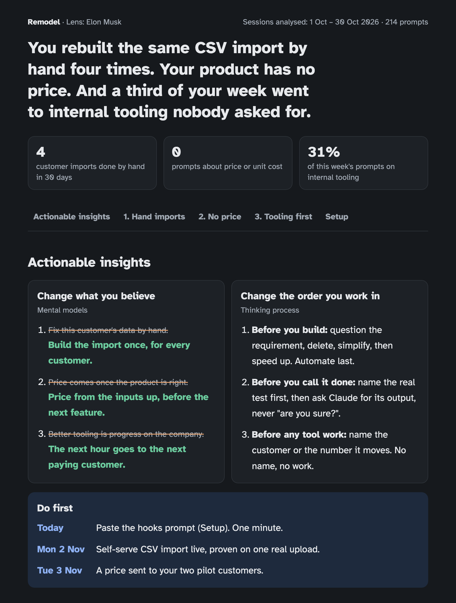

# Remodel

**Fix your thought process and mental model with your history.**

Remodel is a Claude Code skill. It reads your own prompt history, works back from what you
repeatedly do to the thinking behind it, and installs a better habit one card at a time. Every
run publishes a private Claude artifact page: a blunt headline, actionable insights (what to
believe, what order to work in, what to do first), up to three problems with evidence and next
steps, and copy-ready setup prompts. Your taps on the page feed the next run.

### Example

A report for a fictional founder of a small software product, read through the Elon Musk lens
(made-up data; the input is [`docs/example-report.json`](docs/example-report.json)):

<p align="center"></p>

### Usage

```
/remodel                                        # normal mode: fix how you think
/remodel goal "Reach $1M in yearly revenue"     # goal mode: what the goal demands
/remodel goal                                   # goal mode with the saved goal
/remodel elon musk                              # compare your thinking with Elon Musk's
/remodel persona musk                           # same, explicit
/remodel goal "..." persona "jeff bezos"        # goal mode through Bezos's lens
/remodel persona                                # pick the persona that would help most
/remodel --days 14 --match my-app               # narrower window, one folder
/remodel --from 2026-10-01 --to 2026-10-15      # exactly these sessions ("1 to 15 Oct" works too)
```

Rerunning on the same day is safe: the rerun is analysed as the day's only run and compared with
the last run from an earlier day, so you can tweak and rerun without piling up "still not changed".

If the window holds fewer than 60 typed prompts (a quiet month), the digest widens it step by
step (14, 30, 60, 90, 180, 365, 730 days) and says so; the newest prompts still weigh most.

## How it works

```
SPOT ─────► NAME ─────► PRACTICE ─────► PROVE ──► next card
what thinking   a card: trigger    hook sees the       you asked it yourself
drove this?     + question         trigger → Claude    3× in a week → installed
                                   asks the question
```

- **Spot, Name, Prove** run when you call `/remodel` (weekly works best).
- **Practice** runs in every session through two hooks that read the card ledger.
- **Normal mode** mostly finds *process* cards (the order of steps you take).
  **Goal mode** adds *model* cards (what the goal needs you to believe) and strategy calls.
- **Persona lens** writes the whole report in a researched persona's voice (Elon Musk, Bill Gates,
  Jeff Bezos, Warren Buffett, Charlie Munger, Mukesh Ambani): blunt, with their own steps, their
  deadline style and only their real, sourced quotes.

## Personas

A persona is a researched profile of how one person thinks: what they believe (mental models), the
order in which they make big decisions (thinking process), and where that thinking failed them.
Remodel holds your own prompts up against it and shows which of their habits you are missing, with
your prompts as the evidence.

| Persona | Run | How they think | Reach for it when |
|---|---|---|---|
| Elon Musk | `/remodel elon musk` | Question every requirement, price from the atoms up, iterate fast | A product feels slow or costly and you accept its requirements and costs as given |
| Jeff Bezos | `/remodel bezos` | Work backwards from the customer; bet long on what won't change | Choosing what to build next, sizing a bet, deciding how fast to decide |
| Bill Gates | `/remodel bill gates` | Own the standard layer, read deeply, steer by one measure | You build one-off features for single customers instead of a layer others plug into |
| Mukesh Ambani | `/remodel ambani` | Price for all of India, own the chain, survive the worst case | Deciding price, scale and which link to own in a mass Indian market |
| Warren Buffett | `/remodel buffett` | Buy durable cash machines with cheap float, inside what you understand | You chase growth or new domains without counting the capital, cash timing or moat |
| Charlie Munger | `/remodel munger` | Invert, avoid standard stupidities, think in many models, bet big rarely | You plan forward only, inside one discipline, and never ask how it fails or who gains |

Names, surnames and near-misses all work (`elon`, `bezoz`, `buffet`). `/remodel persona` with no
name lets Remodel pick the persona whose fixes would help most right now; the goal breaks ties.

### What a persona run changes

The persona becomes the lens for the whole report, and it is blunt: every persona is brutal about
the habit (never about you), in that persona's own way. Facts never change (what you did, dates,
counts, quotes); the reading of them, the new thinking and the next steps come from the persona.

| Page part | With a persona |
|---|---|
| Top line | Names the lens |
| Headline and each problem's verdict | Written in the persona's tone (their Voice section): what the habit costs, in plain numbers, no softening |
| Quote | Each problem may carry one line from the persona. Words in quotation marks must be copied exactly from the persona file, or `render.py` rejects the report; anything else is marked "(in Remodel's words)" |
| Steps | Every problem walks through the persona's own steps, in order (Musk: question the requirement, delete, simplify, accelerate, automate). `render.py` rejects other step names |
| Deadline | Set in the persona's style (Musk: days; Ambani: a dated target said out loud) |
| Cards | One problem's card is the persona's, active or next in line |

How each persona's bluntness lands:

| Persona | Tone | Steps |
|---|---|---|
| Musk | Blunt engineer: names the waste, then the fix | Question the requirement · Delete · Simplify · Accelerate · Automate |
| Bezos | Calm and relentless, from the customer back | Start from the customer · Write the press release · Name the door · Decide at 70% · One owner, one input |
| Gates | Sharp reviewer, straight to the weakest detail | Read it all first · Check it yourself · Own the layer · Audit one hard detail · Measure it |
| Ambani | Scale-first: what does not work for 100,000 customers is a hobby | Size it for the whole market · Own the bottleneck · Survive the worst case · Build it to repeat · Say a dated number |
| Buffett | Plain and dry, with the arithmetic laid out | Stay in your circle · Check the economics · Test the moat · One price, paid up front · Write down the mistake |
| Munger | The bluntest: inverts and names the stupidity | Settle the no-brainers · In, out or too hard · Run the numbers · Invert · Check incentives and biases |

Each persona also has a **Don't copy** list (Musk's public deadlines, Buffett's refusal of
fast-changing tech); Remodel never recommends those traits.

### What is in a persona file

Each file in `skill/references/personas/` has the same sections:

- **In one minute**: what they built and the one or two habits that made it.
- **Mental models**: 5–7 beliefs, each with a real decision (year, outcome), one question to ask
  yourself, and what a prompt to a coding agent sounds like with and without it.
- **Thinking process**: their order of steps for a big decision, each with an example.
- **More done at the same quality**: how they work faster without dropping quality.
- **Wins** and **Failures**: tables of decisions, the thinking behind them, and what changed after.
- **Public image vs how they decide**, **Don't copy**, and **Applied to a founder**.
- **Bottleneck checks**: 6–8 rows of "bottleneck / how it shows in your prompts / their fix". This
  is the table Remodel compares your digest against.
- **Voice**: tone, the steps every problem follows, deadline style, and how the bad news lands.
- **Practice cards**: 2–3 cards with trigger and proof patterns, so the hooks can practise them.
- **Sources**: 23–33 numbered sources per persona.

### How they were researched

Each persona took 11–18 minutes of research by its own agent, primary sources first: shareholder
letters (Amazon, Berkshire), AGM speeches (Reliance), memos and annual letters (Gates), talks
(Munger, Musk), court records and filings, then reputable biographies and journalism. Failures got
as much room as wins. Every decision, number and date cites a source; quotes are verbatim or left
out, and claims that could not be checked were dropped (the famous "show me the incentive" line
and Buffett's "20-slot punch card" among them). Controversies are stated as documented facts:
rulings, settlements, filings.

### Add your own

Write `<profile>/remodel/personas/<id>.md` following
[`skill/references/persona-format.md`](skill/references/persona-format.md). A custom persona with a
built-in id replaces it. Check it with:

```bash
python3 skill/scripts/collect.py --persona <id> --out /tmp/check
```

The digest's persona section should list its cards, and the card table should show their hits.

## Layout

| Path | What it is |
|---|---|
| `skill/SKILL.md` | The skill: arguments, workflow, how to write the report |
| `skill/scripts/collect.py` | History → recency-weighted digest (+ card signals). No AI. |
| `skill/scripts/render.py` | `report.json` → artifact page (+ PDF with `--pdf`), updates the ledger; `--set-url` remembers the page |
| `skill/scripts/page.py` | The artifact page: tabs, insights, problem blocks, setup; taps saved through the `db` capability |
| `skill/scripts/hook.py` | SessionStart / UserPromptSubmit hook that practises the active cards |
| `skill/references/cards/` | Six starter cards: 3 process, 3 model |
| `skill/references/report-format.md` | report.json fields + ready-made setup snippets |
| `skill/references/card-format.md` | How to write a custom card |
| `skill/references/personas/` | Six researched personas: mental models, thinking process, wins, failures, bottleneck checks, cards, sources |
| `skill/references/persona-format.md` | How to write a custom persona |
| `<profile>/remodel/` | That profile's data: `state.json` ledger (incl. page link), `runs/<date-time>/` (digest, report, taps, page), `cards/`, `personas/`, `nudges.jsonl` |

## Install

Clone the repo and link the skill into your Claude Code skills folder:

```bash
git clone <this repo> remodel
ln -s "$PWD/remodel/skill" ~/.claude/skills/remodel
```

If you run Claude Code with another profile (`CLAUDE_CONFIG_DIR=~/.claude-work`), link it into
that profile's `skills/` folder too. Then run `/remodel` in Claude Code. The hooks and the weekly
schedule are offered in your first report's Setup section, each with a prompt that applies it.

## Data boundaries

- **Isolated per Claude Code profile.** Remodel reads only the history of the profile it runs in
  (`$CLAUDE_CONFIG_DIR`, else `~/.claude`) and keeps everything in that profile's `remodel/` folder.
  A second profile (say `CLAUDE_CONFIG_DIR=~/.claude-work`) gets its own history, report page and
  cards. Profiles never read each other.
- Secrets are masked before any quote reaches a report: API keys in common formats (OpenAI,
  Stripe, GitHub, Google, Slack, AWS), JWTs, private keys, passwords in URLs and `password=…`-style
  values.
- The skill pre-approves only its own scripts and reading files. Writing `report.json` asks you
  first, and the weekly schedule can only write inside the profile's `remodel/` folder.
- The report page lets only you write answers to it. Remodel keeps a tap only as a fixed choice
  and never reads free text from the page.
- Everything except the published page stays on this machine.

## Requirements

Python 3.9+ (stdlib only). Publishing the page needs Claude Code's Artifact tool. The optional
PDF needs Google Chrome or Chromium (`REMODEL_CHROME=/path/to/chrome` to override).

## Tests

```bash
python3 -m unittest discover -s tests -v
```

## License

MIT. See [LICENSE](LICENSE).
